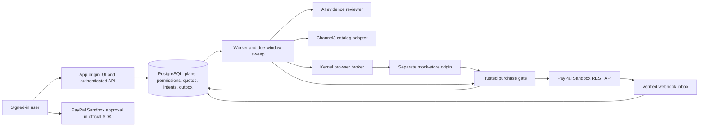
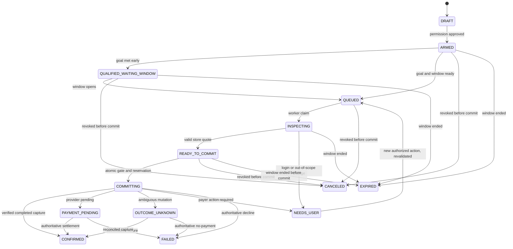

# RewardLoop architecture

This is the target design for the PayPal AI Hackathon build. It describes intended boundaries, not a claim that a provider account, integration, deployment, or payment has been verified. The observed implementation and test state belong in [BUILD_STATUS.md](BUILD_STATUS.md) and [SETUP_STATUS.md](SETUP_STATUS.md).

## Scope and shape

The application lets a signed-in demo user choose a catalog reward, approve an evidence-based goal and a bounded purchase instruction, submit proof, and earn one simulated-store purchase. Every completed payment in the hackathon build must use **PayPal Sandbox**. No route may place a real retailer order, send a live PayPal payment, or promise shipment.

Start with one compact TypeScript package: a Next.js web app plus `src/domain`, `src/db`, `src/integrations`, and `src/worker`. A separate Node worker process can run from the same package. The intended persistence is PostgreSQL, with Drizzle migrations and a Postgres-backed queue plus transactional outbox. Better Auth is the intended app sign-in layer. Keep provider adapters behind small interfaces so the first working slice can use conspicuously labelled fixtures while real access is pending.

The model can recommend an evidence verdict or one action from a fixed shopping tool set. It cannot change a goal, grant purchase permission, run arbitrary code, see payment credentials, or call PayPal. The domain service calculates qualifying distinct days and the purchase gate makes the final decision from trusted database state.

## Trust and origin boundaries

- Use distinct **hostnames**, such as `app.example.test` and `store.example.test`, with host-only cookies and separate app/store sessions. Different ports on `localhost` alone do not isolate cookies. The Kernel navigation allowlist covers only the mock-store host and required static resources. The mock-store session has no app or operator authority.
- Kernel Live View and CDP URLs are bearer capabilities. Return a Live View only to the owning authenticated user during an active setup session; never log or persist its URL. Save the profile by deleting the setup browser through Kernel, then restore it in a different browser session. Serialize profile writers; use a read-only restored profile when execution needs no saved changes.
- The store's browser-facing checkout route cannot accept an arbitrary amount or payment token. It may pass a short-lived, single-use ticket bound to owner, purchase intent, and quote into the same private gate used by the direct adapter. The gate, not the browser or model, owns the PayPal call.
- A saved synthetic cart is linked to an exact purchase intent only through an authenticated action on the app origin. That action verifies the store session belongs to the owner, has been redeemed, and holds an approved SKU and destination. The worker reads the bound session ID, never the most recent session for that owner; a missing or changed cart blocks a provider-backed financial call.
- All ordinary API lookups include the authenticated owner. Operator scenario controls require a distinct role and cannot be reached with the synthetic store session or an LLM tool.

## Reward identity and permission

Channel3 search and URL lookup provide **discovery data**: source product, exact variant and offer references, timestamp, source URL, and an indicative price. An app-owned demo SKU maps to that reference in the controlled store. The synthetic seller, demo SKU/variant, all-in USD cap, synthetic destination, quantity, goal/rubric version, purchase window, and ordered finite alternatives are shown when the user approves permission. The interface and receipt must say that the source retailer does not receive the Sandbox order and no item ships.

Permission is an immutable, hashed snapshot. Changing the goal threshold/rubric, item or alternative set, variant, seller, cap, destination, payment connection, or window creates a new version requiring new approval. Revocation blocks a commit that has not crossed the transaction boundary. A wallet connection by itself grants no purchase authority.

## Evidence, cycles, and scheduling

For a normal submission, record a real receipt timestamp and derive its business date using the goal's pinned IANA timezone; do not accept an arbitrary client-supplied qualifying date. Bind each review and job to the exact goal and rubric versions. A validated model result may qualify at most one distinct local date inside the goal period. Uncertain or malformed output does not count. Operator-seeded history is stored as labelled demo history in a separate scenario run.

Each isolated scenario reset creates a fresh immutable **goal cycle ID** and preserves prior audit and payment records. `purchase_intents.goal_cycle_id` is unique, giving one successful purchase path per cycle. A new worker attempt or a new browser route never creates an independent intent for the same cycle.

Domain changes and work dispatch must be crash-safe: write state and an outbox event in the same transaction, then let the dispatcher enqueue the job. A due-window sweep finds goals that qualified before their window opened. Advancing a demo BusinessClock also writes an outbox event to run that sweep. RealClock controls OAuth/setup-token expiry, leases, network deadlines, and usage accounting; synthetic business time cannot extend provider credentials.

## Quote, reservation, and payment boundary

The mock store, quote, purchase intent, and payment-operation record use the **same PostgreSQL database**. A quote contains the exact demo SKU/variant, seller, quantity, destination, item/tax/shipping breakdown, USD minor-unit total, listing version, and real expiry. Synthetic SKUs have no finite stock count in this slice; the `available` flag and version allow an unavailable-item scenario. A quote is a candidate, not authority to pay.

Immediately before an order-creating or capture-producing call, the server re-reads the current goal cycle, accepted days, active permission and wallet connection, business window, lease fencing token, exact store quote, price cap, and prior successful/unknown operations. In one database transaction it locks those rows, verifies the listing version and availability, reserves the quote for this one intent, moves the intent to `COMMITTING`, and writes an immutable operation payload and stable PayPal request ID. Only after that transaction commits may it send the Sandbox request. The operation cannot switch to a different cart or quote. A later listing change before a financial POST stops that POST. Do not release an ambiguous operation merely because a worker lease expires; a payment may have succeeded. If finite stock is added, implement an actual quantity reservation in this same transaction before allowing a payment.

After PayPal reports a completed capture, an idempotent database transaction records the actual order/capture IDs, confirms the synthetic store order once, and issues the receipt. Verify merchant, payment source ownership, amount, currency, and intent association against the frozen payload. A callback, page string, or fixture cannot establish real payment success. For a timeout with an unknown order ID, retry only the identical operation within the endpoint's documented idempotency window. After that window, block a new charge pending investigation.

`NEEDS_USER` after PayPal created an order retains that order ID and its frozen quote. Later buyer approval must not create a replacement order by default; before any subsequent capture, the gate checks that permission, goal, window, amount, and reservation are still valid. `OUTCOME_UNKNOWN` cannot return to shopping or choose a different item until reconciliation proves no payment. A cancellation requested during `COMMITTING` is recorded as pending outcome, not represented as preventing an in-flight Sandbox call.

## PayPal capability gate and fallback

At startup, require `PAYPAL_ENV=sandbox` and the exact Sandbox REST host; expose no live-mode switch. Vault setup is a separate human approval: app server obtains a short-lived ID token, creates a setup token, binds it to user and CSRF state, exchanges the approved token for a durable payment token, and keeps the latter server-side. PayPal's current [Payment Method Tokens guide](https://developer.paypal.com/api/payment-tokens/save-without-purchase/paypal) says billing-agreement/reference-transaction capability requires approval and configuration. A Vault toggle alone does not prove unattended payment works. Probe this in Phase 0 when credentials are available and record the observed response.

If the account cannot complete that capability after a bounded probe, use an explicitly labelled **fresh approval required** PayPal Sandbox checkout: the goal still unlocks the purchase, but a human approves the order before server capture. This is a real Sandbox route and must never be described as unattended. Every mutation has its own persisted `PayPal-Request-Id`; [PayPal's endpoint references](https://developer.paypal.com/api/orders/v2/orders-create/) give different retention periods, so retries follow the specific endpoint contract. A saved-wallet order can already contain a completed capture; inspect the full response or retrieve the order before considering a separate capture.

## Implementation order and evidence

1. Phase 0: inspect existing resources, document setup and build state, validate current provider contracts, and probe Sandbox OAuth/Vault when credentials exist.
2. First runnable slice: signed-in demo user → fixed demo SKU → goal and immutable permission → labelled fixture proof review → code-counted qualification → shared backend gate → fixture receipt. Persist every step and exercise the outbox worker.
3. Replace the payment fixture with genuine PayPal Sandbox as soon as access allows. Then connect actual Channel3 results and an actual evidence model, followed by Kernel's two-session store flow. All routes continue through the same intent and gate.
4. Record per-run provenance: catalog (Channel3/fixture), evidence (model/fixture/manual), browser (Kernel/direct/fixture), and payment (PayPal Sandbox/fixture). Only provider-backed results count toward the full hackathon demonstration.

Sources for the provider-specific design: [PayPal saved wallet](https://developer.paypal.com/api/payment-tokens/save-without-purchase/paypal), [PayPal Orders create](https://developer.paypal.com/api/orders/v2/orders-create/), [PayPal idempotency](https://developer.paypal.com/api/rest/requests/), and [Kernel saved profiles](https://www.kernel.sh/docs/browsers/profiles/save-and-reuse). These describe possible flows; integration status must be established by observed tests.
